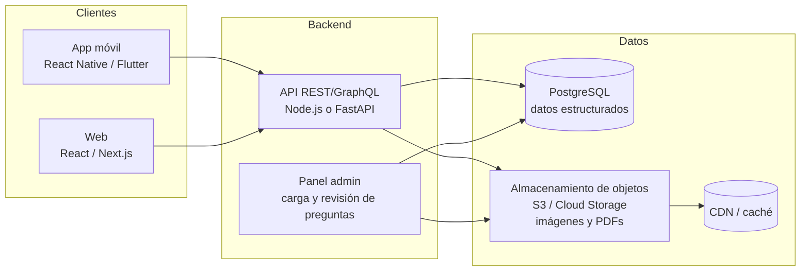

# Tarea 6 — Arquitectura técnica

> Estado actual del repo: demo single-file (vanilla, sin build) + React/Vite para
> despliegue en Vercel + Supabase (auth + sync de progreso). Esta propuesta define
> la arquitectura escalable de producción según el prompt.

## 1. Diagrama general

## 2. Componentes y decisiones

| Capa | Propuesta | Justificación |
|---|---|---|
| Frontend móvil | **React Native** (puede compartir tipos y lógica con React web) | Un solo ecosistema JS; reutiliza el modelo de datos de la Tarea 2 |
| Frontend web | **React (Vite) o Next.js** | El repo ya tiene React/Vite funcionando con Vercel |
| Backend | **Node.js (Fastify) o FastAPI** | Ambos válidos; Node mantiene un solo lenguaje con el front. FastAPI si se prefieren herramientas Python para analítica |
| Base de datos | **PostgreSQL** | Datos estructurados (preguntas, intentos, resultados); compatible con Supabase |
| Almacenamiento | S3 / Cloud Storage (Cloudflare R2 es alternativa sin costos de salida) | Imágenes de preguntas, cuadernillos, audios TTS si aplica |
| Autenticación | Correo + Google (OAuth), opcional cuenta institucional (Supabase Auth ya integrado) | El demo ya trae login por correo; Google reduce fricción estudiantil |
| Analítica | Eventos de práctica, simulacros, errores y tiempo de respuesta (tabla `eventos`) + dashboards | Medir qué preguntas fallan más y por competencia |
| Offline | PWA (el repo ya trae `sw.js`) + descarga de módulos/simulacros empaquetados (JSON + imágenes) y cola de sincronización | Estudiantes con conectividad intermitente |
| Administración | Panel para cargar, revisar, editar y publicar preguntas con flujo borrador → revisión → publicado | Control de calidad del contenido oficial y generado |
| Despliegue | Vercel (web) + Supabase (auth/DB) + backend propio solo si se necesita | El repo ya despliega web en Vercel |

## 3. Modelo de datos mínimo

Definido en [`modelo-datos.sql`](modelo-datos.sql) (PostgreSQL). Entidades:
`usuarios`, `examenes`, `modulos`, `competencias`, `preguntas`, `opciones`,
`respuestas_usuario`, `intentos`, `simulacros`, `resultados`, `planes_estudio`,
`contenidos`, `fuentes`, `licencias`.

Puntos clave:
- `preguntas` referencia a `fuentes` (cada pregunta oficial lleva su URL y licencia).
- `opciones` separadas de `preguntas` para soportar 3 o 4 opciones (Inglés usa A–C en algunas partes).
- `respuestas_usuario` guarda cada respuesta individual con tiempo; `intentos` agrupa una sesión de práctica; `simulacros`/`resultados` cubren el modo examen.
- Contenido oficial vs. generado: columna `fuente` (`ICFES` | `Generada por la aplicación`) y `explicacion_generada` (bool), heredadas del esquema de la Tarea 2.

## 4. Relación con lo ya construido

- **Demo (HTML vanilla)** sigue siendo el producto de práctica y prototipado; exporta su estado por el puente v19 (postMessage) hacia React/Supabase.
- **React/Vercel/Supabase** (ya en el repo) es la base de la web de producción; este documento escala esa base.
- **banco v21** (generadores deterministas) puede migrar a un worker del backend para servir preguntas sin duplicar memoria en el cliente.
